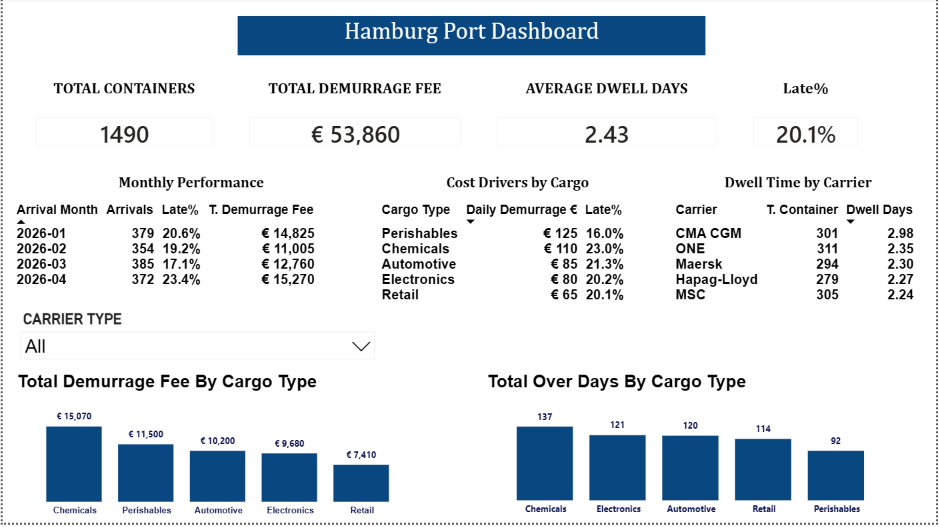
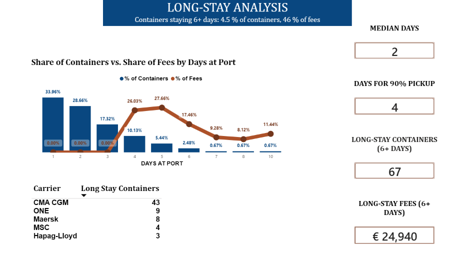

# Hamburg Port Dwell Time Analysis

**Where do container demurrage fees come from, and what can be done about them?**

An end-to-end data analysis project using **SQL (PostgreSQL)**, **Excel** and **Power BI**. I analyze how long 1,490 containers stayed at the Port of Hamburg and which carriers and cargo types drive the demurrage fees.




---

## Business Problem

When a container stays at the port longer than the free period (here: 3 days), the customer pays a daily **demurrage fee**. These fees are a real cost for shippers and an important number for port operations.

This project answers simple but important questions:

- How long do containers stay at the port?
- Which containers cause most of the fees?
- Which carriers are slowest?
- Which cargo types cost the most, and is that because of **high rates** or **late pickups**?
- What would happen to fees if the free period changed?

---

## Key Results

| KPI | Value |
|---|---|
| Total containers | 1,490 |
| Total demurrage fees | € 53,860 |
| Average dwell time | 2.43 days |
| Containers picked up late | 20.1 % |
| Median dwell time | 2 days |
| 90 % of containers picked up within | 4 days |

---

## Key Insights

**1. Fees come from a minority of late containers.**
The average container is collected in 2.43 days, inside the 3-day free period. Only about 1 in 5 containers is late, and these create all the fees. That small group is where action should focus.

**2. A small group of long-stay containers causes almost half of all fees.**
The median is 2 days and 90 % of containers are picked up within 4 days, so the average hides the problem. Only **67 containers (4.5 %)** stayed 6 days or more, but they created **46 % of all fees (€ 24,940)**. **43 of these 67 belong to CMA CGM.** The cargo types are spread evenly in this group, so the long stays are linked to the carrier, not to the cargo.



**3. CMA CGM is the slowest carrier.**
CMA CGM averages 2.98 days, right at the 3-day limit, compared to 2.24 days for MSC. All carriers handle a similar volume (279 to 311 containers), so volume does not explain the difference.

**4. Chemicals are the biggest cost driver, and the problem is delay.**
Chemicals create 28 % of all fees. They combine a high daily rate (€ 110) with the highest late share (23 %). This is an **operational problem** that can be improved, for example by checking customs or document delays.

**5. Perishables are expensive because of the tariff, not delay.**
Perishables have the highest daily rate (€ 125) but the *best* pickup rate (only 16 % late). Their cost is a **pricing effect**. Faster pickup would not change much here.

**6. More volume did not mean more delay.**
March had the most arrivals (385) but the fewest late containers (17.1 %). April was the weakest month (23.4 % late).

**7. The free period has a big impact on fees.**

| Free period | Total fees |
|---|---|
| 2 days | € 105,105 |
| **3 days (current)** | **€ 53,860** |
| 4 days | € 26,250 |
| 5 days | € 12,660 |

Cutting the free period to 2 days would roughly double the fees. This is an upper limit, because customers would likely pick up faster.

---

## Recommendations

1. **Investigate Chemicals first.** It is the largest cost driver and the problem is fixable. Check whether containers are waiting on customs clearance or paperwork.
2. **Talk to CMA CGM.** Its average sits right at the free-period limit, and it accounts for 43 of the 67 long-stay containers. Its cargo mix does not explain this, so the cause is likely in its pickup or handover process.
3. **Don't target Perishables for faster pickup.** Their cost comes from the rate, not from delay.

---

## Tools and Skills

| Tool | What I used it for |
|---|---|
| **PostgreSQL** | Data loading, aggregation, `CASE WHEN` logic, subqueries, median and percentile (`percentile_cont`), scenario analysis |
| **Excel** | Data cleaning, date formatting, formula checks |
| **Power BI** | Two-page interactive dashboard with DAX measures, KPIs, carrier filter and charts |

**Skills used:** data cleaning, data validation, KPI design, business analysis, scenario modeling, data visualization, clear communication of results.

---

## Data Quality Check

Before using any numbers, I checked whether the stored fees were correct. I recalculated every fee from the daily rate and the days over the free period:

| | Amount |
|---|---|
| Fee stored in the data | € 53,860 |
| Fee recalculated | € 53,860 |

The two match exactly, so the data is reliable for reporting.

I also fixed a date problem: the source file uses **DD/MM/YYYY** dates. Without setting the date order before loading, the months load incorrectly.

---

## Project Structure

```
hamburg-port-dwell-time-analysis/
│
├── dashboard/
│   ├── hamburg_port_dashboard.pbix
│   ├── dashboard_preview.png
│   └── long_stay_analysis.png
├── data/
│   ├── hamburg_port_container_data.csv
│   └── hamburg_port_container_data.xlsx
├── docs/
│   └── business_questions_and_insights.docx
├── sql/
│   └── dwell_time_analysis_queries.sql
└── README.md
```

---

## Dataset

| Column | Description |
|---|---|
| `container_id` | Unique container number |
| `carrier` | Shipping line (Maersk, MSC, Hapag-Lloyd, CMA CGM, ONE) |
| `cargo_type` | Chemicals, Perishables, Automotive, Electronics, Retail |
| `arrival_date` | Date the container arrived at the port |
| `pickup_date` | Date the container was picked up |
| `actual_delivery_days` | Days the container stayed at the port |
| `free_days_allowed` | Free period before fees start (3 days) |
| `daily_demurrage_fee` | Fee per day after the free period (€) |
| `actual_demurrage_fee` | Total fee charged (€) |

**Period:** January to April 2026 · **Size:** 1,490 rows

---

## Limitations

- The dataset is **synthetic (AI-generated)**. It shows the analysis method, not real Port of Hamburg data.
- The same 3-day free period is used for all containers. In real life it differs by carrier, cargo and contract.
- Differences between groups are not statistically tested.
- The data shows *where* fees come from, not *why*. The causes above are ideas to check with operational data.

---

## How to Run

1. Create a PostgreSQL database.
2. Open `sql/dwell_time_analysis_queries.sql`.
3. In the `COPY` line, change the file path to where you saved `data/hamburg_port_container_data.csv`, then run the table setup and the `COPY` command.
4. Run the queries. The expected result is shown under each query.
5. Open `dashboard/hamburg_port_dashboard.pbix` in Power BI Desktop to explore the dashboard.

---

## Contact

**Dolly**\
Data Analyst\
Hamburg, Germany\
[dollykhanna3210@gmail.com](mailto:dollykhanna3210@gmail.com)
